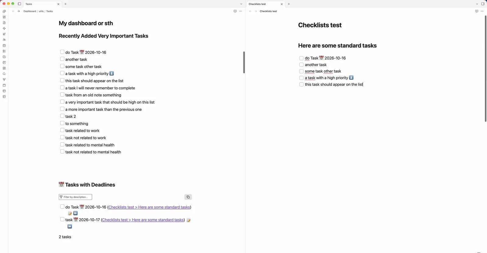

# Checkboxes

**Checklists that aren't tasks.**

In Obsidian, every `- [ ]` is a task. 
Meanwhile, your grocery list, the one for next week, and the one for the party all land in the Tasks plugin's queries, in Dataview task lists, in task: searches, and in every dashboard built on them. 
Totally unwanted.
Checkboxes adds a second kind of box, `- ( )`, that you can tick just the same but that no task tool ever picks up.



> [!important] Not a replacement for Tasks
> Checkboxes does not manage tasks: no due dates, priorities, recurrence or queries. Keep using the [Tasks](https://github.com/obsidian-tasks-group/obsidian-tasks) plugin, Dataview or native tasks for your to-dos. Checkboxes takes care of everything else, so your task views show only real tasks.

## Two kinds of boxes

```markdown
## This week
- [ ] Send the reviewer response 📅 2026-10-20    ← a task: Tasks, Dataview and your dashboard see it

## Groceries
- ( ) Oat milk                                   ← a checklist item: nothing but this note sees it
- (x) Coffee ✅ 2026-10-16                         ← checked, with the day you checked it
- (-) Avocados                                    ← skipped: struck through, not counted
```

Both kinds can live in the same note. A party note can hold "Order the cake 📅" as a task and the groceries as checklist items.

## Features

- **Clickable boxes everywhere you read a note:** Live Preview, Reading view, embeds and hover previews. They use your theme's own checkbox, so they look like the boxes you already have.
- **Done dates:** checking writes `✅ 2026-10-16`, unchecking removes it.
- **Progress bars where you want them:** a small `checkboxes` code block draws a filling bar with `14/42` for the section it sits in, a heading of your choice, or another note. It can stay pinned at the top while you scroll through its section.
- **Counts on headings,** such as `3/6`, so a grocery list shows at a glance which part of the shop is done. A heading counts its subheadings too.
- **Hide checked** on a progress bar shows only what is left.
- **Faint checked items** with a grey ✅, so the open ones stand out.
- **A count in the status bar** for the note you are in, if you turn it on.


## Usage

| Do this                           | How                                                                                 |
| --------------------------------- | ----------------------------------------------------------------------------------- |
| Start a checklist item            | Type `- ( ) `, or run **Toggle checklist item** on a line                           |
| Check or uncheck                  | Click the box, or run **Toggle checklist item**                                     |
| Skip an item                      | Write `- (-)` instead of `- ( )`                                                    |
| Turn a task into a checklist item | Run **Toggle checklist item** on the task (a checked task stays checked)            |
| Convert a whole note              | Command **Convert tasks in this note to checklist items** (one undoable step)       |
| Add a progress bar                | A `checkboxes` code block, see [Progress bars](#progress-bars)                      |
| Show only open items              | **Hide checked** on a progress bar, or the command **Hide or show checked items**   |

**Toggle checklist item** works on the cursor line or on every selected line. It has no hotkey out of the box, so it cannot clash with yours; **Cmd/Ctrl+Shift+L** is a good choice under **Settings → Hotkeys**. Obsidian's own **Cmd/Ctrl+L** keeps toggling tasks, so both kinds are then one shortcut away.

## Progress bars

Put a `checkboxes` code block where you want a bar:

````markdown
```checkboxes
progress
```
````

It counts the checklist items of the section it sits in, subheadings included: at the top of a note it counts the whole note, under `## Weekend` the whole weekend shopping with its subheadings, under `### Fruits and vegs` only that list. The word `progress` is optional; it just tells anyone reading the raw text what the block is.

To count something else, add a heading, a note, or both:

````markdown
```checkboxes
progress
heading: Fruits and vegs
note: Grocery list
```
````

A bar that counts its own note has a **Hide checked** switch. With **Sticky progress bar** on (the default), the bar stays at the top of the note while you scroll through its section; with bars in nested sections, the innermost one is shown.

## Without the plugin

The lines stay readable: `- ( ) Oat milk` and `- (x) Coffee ✅ 2026-10-16` are plain text in any editor, on GitHub, in an export or on a phone without the plugin. To check an item there, type an `x` between the brackets. Nothing is stored outside your notes.

## Compatibility

- Works on its own: Tasks and Dataview are not needed. Alongside them, and with any theme, it works too; task plugins only read `- [ ]`, so they never see checklist items.
- Desktop and mobile.
- Source mode shows the raw `- ( )` text, like it shows `- [ ]`.
- Lines starting with `- (a)` or `- (1)` stay ordinary text: only `- ( )`, `- (x)`, `- (X)` and `- (-)` are checklist items.
- In an embed or hover preview, a click finds the item's line by its text. If a note has two items with the same text under the same heading, a notice asks you to tick it in the note itself.

## Settings

Done dates, heading counts, the sticky progress bar and dimming of checked items can each be turned off. The status-bar count is off until you turn it on.

## Installation

To install it by hand, download `main.js`, `manifest.json` and `styles.css` from the [latest release](https://github.com/adalach/obsidian-checkboxes/releases/latest) into `<vault>/.obsidian/plugins/checkboxes/` and turn it on under **Settings → Community plugins**. [BRAT](https://github.com/TfTHacker/obsidian42-brat) can install pre-releases from `adalach/obsidian-checkboxes`.


## Development

Building from source, the tests and the code layout are described in [DEVELOPMENT.md](DEVELOPMENT.md).

## License

[MIT](LICENSE) © Agata Dalach
